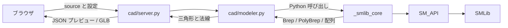

<!-- SPDX-FileCopyrightText: Copyright (c) 2026 NVIDIA CORPORATION & AFFILIATES. All rights reserved. -->
<!-- SPDX-License-Identifier: Apache-2.0 -->

# ローカルモデラ向け `_smlib_core` とツール境界 API

この文書は、2026-10-16 時点の作業ツリーで追加した USD 非依存の Python 拡張と、隣接する `cad` ローカルモデラとの接続契約を記録する。対象は `source/SmPyCore/`、`premake5.lua`、`source/SM_API/src/SmApiImportExport.cpp` の変更である。以下の仕様は実装済みの `_smlib_core` に基づく。既存の `_omni_solid`、USD スキーマ、USD ファイル形式の仕様を変更するものではない。

## 今回の修正

| ファイル | 変更内容 | 目的 |
| --- | --- | --- |
| `source/SmPyCore/src/SmPyCore.cpp` | pybind11 モジュール `_smlib_core` を追加。プリミティブ生成、Boolean、全エッジの面取り・丸め、テッセレーション、メッシュ配列化を `SM_API` に接続 | ローカルツールに必要なモデリング機能を USD なしで利用する |
| `source/SmPyCore/stubs/_smlib_core.pyi` | Python の公開名、引数、戻り値の型を記述 | ツール側の補完と静的参照 |
| `source/SmPyCore/tests/test_core.py` | 箱のテッセレーションと Boolean の消費契約を確認 | 最小限の境界動作を確認 |
| `source/SmPyCore/premake5.lua`、`premake5.lua` | `SMLib` と `SM_API` にリンクする Python 3.12 拡張を通常のプロジェクトに追加 | macOS の USD 未導入構成でもプロジェクトを生成できるようにする |
| `source/SM_API/src/SmApiImportExport.cpp` | `SmApiGetOrCreateContext()` の宣言元 `SmApiGeneral.h` を明示的に include | 単独ビルドでの宣言依存を解消 |

`_smlib_core` は Python 3.12 と pybind11 を使い、`SMLib` / `SM_API` に依存する。`SM_API_USD`、`pxr`、OCCT にはリンクしない。リポジトリの Premake 定義は `_smlib_core` を USD 依存スタックの外で include する。隣接ツール `cad/Makefile` は Apple Silicon 向けに同じソースを直接コンパイルし、単一の `.so` にリンクする別のビルド経路である。

## 境界とデータの流れ



`_smlib_core` の境界は **プロセス内 Python API** である。`cad/modeler.py` はテキスト命令または Python コードを評価し、`sm` という名前でモジュールを呼び出す。材質、HTTP、プレビュー用三角形化、GLB のエンコードはツール側が所有する。`_smlib_core` は USD 入出力、ファイル保存、材質、HTTP を提供しない。

## Python API

`import _smlib_core as sm` を使う。位置はモデル単位の有限な数値を持つ **3 要素の tuple**。戻り値の `Brep` と `PolyBrep` はネイティブオブジェクトの Python ハンドルである。

| 関数 | 必須引数（記載順） | 追加引数 | 戻り値・形状 |
| --- | --- | --- | --- |
| `create_box` | `origin, length, width, height` | — | `Brep`、原点から +X/+Y/+Z の箱 |
| `create_sphere` | `center, radius` | — | `Brep`、球 |
| `create_cylinder` | `base, radius, height` | `axis=None` | `Brep`、底面中心から軸方向の円柱 |
| `create_cone` | `base, radius_base, radius_top, height` | `axis=None` | `Brep`、円錐または円錐台 |
| `create_torus` | `center, radius_major, radius_minor` | `axis=None` | `Brep`、トーラス |
| `create_pyramid` | `base, length, height` | `axis=None` | `Brep`、四角錐 |
| `create_cylindrical_box` | `base, length, inside_radius, outside_radius, start_angle_deg, end_angle_deg` | `axis=None` | `Brep`、中空円柱の扇形 |
| `create_partial_sphere` | `center, radius, start_angle_deg, end_angle_deg` | `axis=None` | `Brep`、方位角方向の球扇形 |
| `create_partial_cone` | `base, radius_base, radius_top, height, start_angle_deg, end_angle_deg` | `axis=None` | `Brep`、円錐の扇形 |
| `create_partial_cylinder` | `base, radius, height, start_angle_deg, end_angle_deg` | `axis=None` | `Brep`、円柱の扇形 |
| `create_partial_torus` | `center, radius_major, radius_minor, start_angle_deg, end_angle_deg` | `axis=None` | `Brep`、トーラスの扇形 |
| `create_ellipsoid` | `center, radius_x, radius_y, radius_z` | — | `Brep`、球を中心から各軸方向にスケールした楕円球 |
| `create_sphere_no_pole` | `center, radius` | — | `Brep`、極特異点のない球 |
| `create_plane` | `origin, length, width` | — | `Brep`、厚みのない平面 |
| `create_planar_circle` | `origin, radius` | — | `Brep`、厚みのない円面 |
| `create_profile` | `points` | — | 再利用可能な `Profile`。穴なし多角形の2D点列 |
| `create_extrude` | `profile, origin, start, end` | `axis=None, xdir=None` | 両端を閉じた押し出し `Brep` |
| `create_revolve` | `profile, origin, start_angle_deg, end_angle_deg` | `axis=None, xdir=None` | 全回転または端面を閉じた部分回転 `Brep` |
| `boolean_union` / `boolean_difference` / `boolean_intersection` | `a, b` | — | `a` と同じ `Brep` ハンドル。`b` を消費 |
| `chamfer_fillet` / `circular_fillet` | `brep, radius` | — | 入力と同じ `Brep` ハンドルを変更して返す |
| `tessellate` | `brep` | `chord_height_tolerance=0.0`, `curve_angle_tolerance_deg=25.0`, `surface_angle_tolerance_deg=25.0` | `PolyBrep` または `None` |

`Brep.valid` はハンドルが未消費なら `True`。`PolyBrep.to_numpy_arrays()` は名前に反して **NumPy 配列ではなく Python の list を含む dict** を返す。型スタブの詳細は `source/SmPyCore/stubs/_smlib_core.pyi` を参照する。

### 入力値と座標系

- 座標と `axis` の各成分は有限値。長さ、高さ、半径、面取り幅は原則として有限な正数。円錐の両半径は 0 以上で、少なくとも一方は正数。トーラスは `radius_major > radius_minor > 0`、中空円柱は `outside_radius > inside_radius > 0`。
- `axis=None` は +Z。指定する場合は非ゼロの 3 要素 tuple とし、長さは方向以外に影響しない。ローカル +Z から指定方向への最短回転を使う。-Z の場合は +X 軸回り 180° とする。
- `start_angle_deg` / `end_angle_deg` はローカル XY 平面の +X からローカル +Z 軸回りに測る度数。`0 < end - start <= 360`。`partial_sphere` はこの方位角の扇形であり、半球を表す名前ではない。
- ネイティブ形状とメッシュ座標は Z-up。単位は API では規定しないため、呼び出し側が統一する。ツールは GLB 書き出し時に Y-up へ変換する。

### 所有権と失敗

`Profile` はネイティブ曲線を保持しない2D点列の値です。`create_profile` は3〜1024頂点の有限な単一輪郭を検査し、自己交差・自己接触・重なり・ゼロ長辺・ゼロ面積を拒否して反時計回りに統一します。終点に始点を再記載しても構いません。`Profile.points` は点列のコピーを返します。

`create_extrude` はローカルXY断面を軸方向の距離 `start < end` の間に押し出し、`create_revolve` は `(半径, 高さ)` 断面を回転します。回転半径は0以上で、軸に接してよく、角度範囲は `0 < end-start <= 360` 度です。原点は距離0／高さ0の軸上にあります。`xdir` はローカル+X／角度0の半径方向で、軸に垂直な面へ投影して正規化します。軸に平行な `xdir` は拒否し、省略時は既存プリミティブと同じ最短回転を使います。

生成ごとに一時的な `SmLine` を `SmApiCreateLineSegment` で作り、入力曲線をコピーする `SmApiCreateLinearSweep` / `SmApiCreateRotationalSweep` に渡します。一時曲線は成功・失敗のどちらでも解放し、元の `Profile` と呼び出し側の点列は変更しません。生成後に `SmApiBrepIsManifoldSolid` を確認し、閉じたソリッドにならなければ `RuntimeError` にします。円弧・スプライン・穴付き断面はこのAPIでは未対応です。

- 生成関数は新しい `Brep` を返す。Boolean の成功時は `a` をその場で変更して同じハンドルを返し、`b.valid` は `False` になる。消費済み `b` を再利用すると `ValueError`。同一ハンドルを両入力に渡すことも `ValueError`。
- Boolean の失敗時は C++ API の契約に従い、両入力は解放されないが、形状が変更されている可能性がある。失敗後に元形状が保たれていると仮定しない。
- 面取り・丸めは入力をその場で変更し、同じハンドルを返す。`tessellate` は入力形状を論理的には変更せず、新しい `PolyBrep` を返す。
- 形状パラメータの検査と消費済みハンドルは `ValueError`、`SM_API` の失敗は操作名と数値ステータスを含む `RuntimeError`。返却ポインタが null の場合も `RuntimeError`。テッセレーションが成功ステータスで null を返した場合は `None`。

### メッシュ配列の契約

`poly.to_numpy_arrays()` の返り値は次の 4 キーを持つ。

| キー | 型・内容 |
| --- | --- |
| `points` | `[(x, y, z), ...]`。共有頂点の座標 |
| `faces` | フラットな整数列。各多角形を `[頂点数, 頂点 index, ...]` として連結 |
| `face_normals` | 各出力多角形の向き付き面法線 `(nx, ny, nz)` |
| `corner_normals` | 多角形ごとの頂点法線列。`face_normals` と同じ順序、各列はその面の頂点数と同じ長さ |

多角形は三角形とは限らない。ツールの `modeler._triangles()` が穴なしの凸・凹多角形を耳切り法で分割し、内部対角線の交換で最小角を改善してから面法線に合わせて巻き順を補正する。境界と頂点数を保持し、角度は元の3D座標で評価する。`corner_normals` は曲面上で滑らかな陰影を維持し、箱のような稜線では面ごとに異なる法線を保持する。配列化時、外周ループがない面、3 辺未満の面、頂点 index を解決できない面は出力から除外される。ツール側は空メッシュをエラーとする。

## ツールとの接続例と検証

```python
import _smlib_core as sm

body = sm.create_box((-10, -10, 0), 20, 20, 8)
cutter = sm.create_cylinder((0, 0, -1), 2, 10)
result = sm.boolean_difference(body, cutter)
assert result is body and not cutter.valid
mesh = sm.tessellate(result, chord_height_tolerance=0.08,
                     curve_angle_tolerance_deg=20,
                     surface_angle_tolerance_deg=20)
arrays = mesh.to_numpy_arrays()
```

隣接する `cad/modeler.py` は、メッシュ化時に弦高 `0.001..2` と角度 `1..90°` を受け付け、`faces` を三角形化して `positions` / `normals` を作る。`cad/server.py` の `/preview` はそれを JSON として返し、`/export` は同じ評価とメッシュ化処理から GLB を生成する。これらの HTTP パス、材質指定、テキスト命令は **ツールの API** であり、`_smlib_core` の公開 API には含まれない。

Apple Silicon のローカルツールでの検証例（`cad` ディレクトリから実行）:

```bash
make -j4
PYTHONPATH="$PWD/.build/smlib-core:$PWD" \
  "$PWD/.packman-cache/python/3.12.14-macos-aarch64/bin/python3.12" \
  -m unittest discover -s usd-brep/source/SmPyCore/tests -v
PYTHONPATH="$PWD/.build/smlib-core:$PWD" \
  "$PWD/.packman-cache/python/3.12.14-macos-aarch64/bin/python3.12" \
  -m unittest discover -s tests -v
```

この経路はローカルツールの直接リンクビルドの確認である。リポジトリ標準の Premake / `repo.sh build` 経路については別途その構成で確認する。
